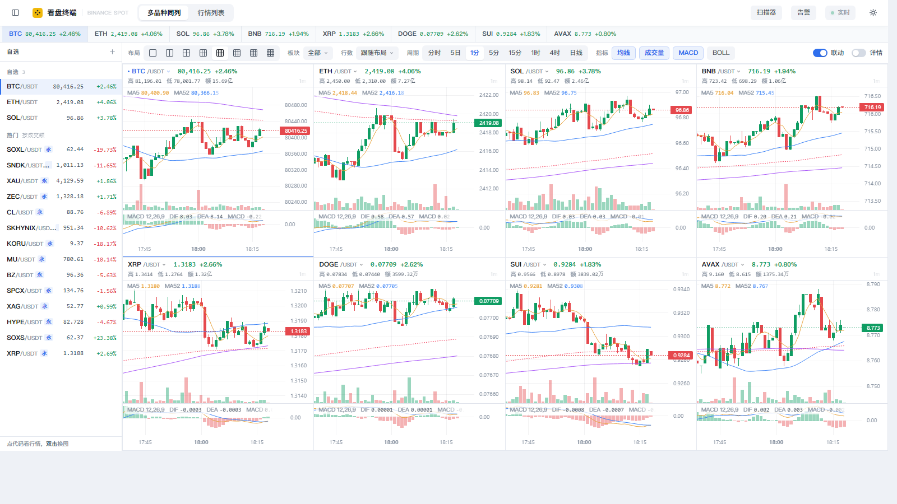
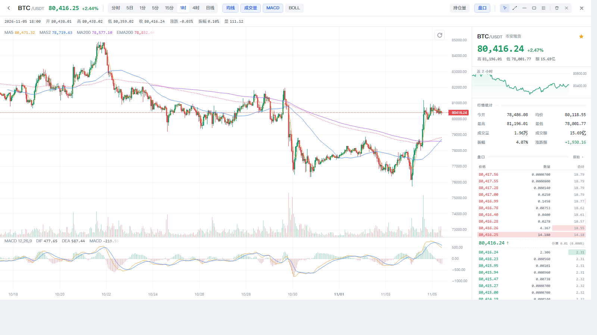
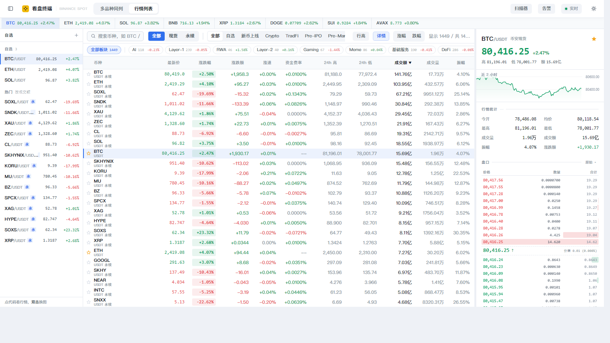
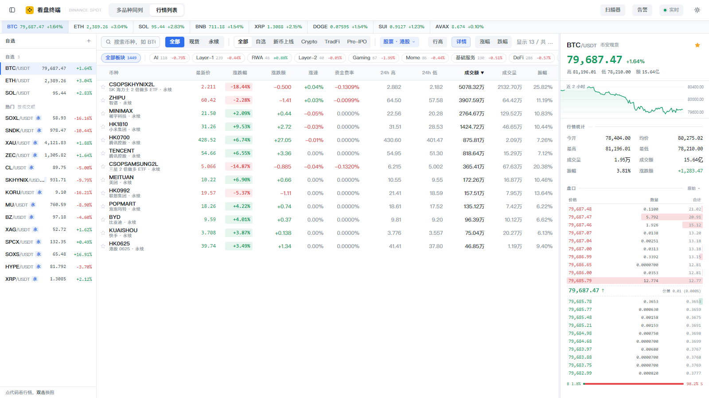

# 币安看盘终端（本地版）

> **它只解决一个问题**：币安网页端没法把几十个品种同时平铺开来看。

币安网页版的 K 线页面一次放不下几张图，想看别的品种就得回列表重新点；
行情列表和 K 线分成两个页面，来回跳；盘口、资金费率、持仓量又散在另外几处。
盯十几个币的时候，时间全耗在切换上，而不是看盘。

这个工具把这几个动作压到一屏：**最多 400 个品种铺成一面墙**，每格都是独立可交互的实时 K 线，
价格和涨跌幅跟着表头一起刷新；一屏放不下就往下滚，或者双击任意一格进大图。

纯本地运行：不登录、不下单、不需要 API Key、不往任何服务器发数据。



---

## 和币安网页端比，差在哪

| | 币安网页端 | 这里 |
|---|---|---|
| 同屏品种数 | 几张图 | 1 ~ 400 格（1×1 到 4×4，或「铺满全部品种」） |
| 换品种 | 回列表重新选 | 点格子左上角直接搜；左侧自选栏点一下 |
| 行情列表 + K 线 | 两个页面来回跳 | 两个视图，`1` `2` 一键切 |
| 多图联动 | 无 | 拖任意一张，其余同步缩放平移，十字光标对齐同一时刻 |
| 批量填充 | 无 | 选一个板块，当前布局的格子一键填满 |
| 永续资金费率排序 | 要一个个点进去看 | 791 个合约排一张表，按年化 / 基差 / 成交额排序 |
| 板块 / 页签筛选 | 有限 | 现货与永续两级分类，11 个板块 × 9 个页签可叠加 |
| 绘图工具 | TradingView 全套 | 趋势线 / 水平线 / 矩形 / 斐波那契 + 撤销（够用，但不如官方全） |
| 需要登录 | 是 | 否 |

---

## 快速开始

### 方式一：直接跑源码（最快，需要 Python 3.8+）

```bash
git clone https://github.com/xiaoxin7534/binance-terminal.git
cd binance-terminal
python server.py --open
```

浏览器会自动打开 <http://127.0.0.1:8848/>。
只用 Python 标准库，**不需要 pip install 任何东西**。

- 换端口：`python server.py --port 9000 --open`
- 给同局域网的手机 / 平板看：`python server.py --host 0.0.0.0`（然后用电脑 IP 访问）

### 方式二：打包成 exe（给没装 Python 的电脑用）

仓库里**不放二进制文件**（`dist/` 已忽略），需要本地打一次：

```bash
python tools/pack.py               # 构建 exe + 组装目录 + 压成便携 zip
python tools/pack.py --skip-build  # 复用现有 exe，只重打包
```

产物：

| 文件 | 用途 |
|---|---|
| `dist/BinanceTerminal.exe` | 单文件，双击即用，目标机不用装 Python |
| `dist/币安看盘终端_YYYY-MM-DD.zip` | 便携包（exe + 使用说明 + 代理模板），解压就能用 |

Windows 上也可以直接双击 **`打包exe.bat`**。打包需要 PyInstaller，
脚本会自动建 `build/.venv` 装上，不污染系统 Python。

> 首次运行 Windows 会弹「已保护你的电脑」——exe 没有数字签名，点「更多信息 → 仍要运行」。
> 想要桌面图标：双击 **`创建桌面快捷方式.bat`**。

### 在 iPad / 手机上打开

电脑和 iPad 连**同一个 Wi-Fi**，然后让服务监听局域网：

```bash
python server.py --host 0.0.0.0      # 源码版
```

打包版双击 **`局域网访问.bat`**——它会先打印出本机局域网地址（形如 `http://192.168.0.66:8848/`），
再以局域网模式启动。把这个地址在 iPad 的 Safari 里打开即可。

> 首次启动 Windows 可能弹防火墙提示，选「允许访问」（**专用网络** 就够）。
> 端口被占用时换一个：`BT_PORT=9000`（bat 里改也行）。

**iPad 上的建议**（界面是按桌面设计的，屏幕小的时候要调一下）：

- **横屏**用，竖屏 768px 宽太挤
- 关掉左侧自选栏（顶栏左起第一个按钮），4×2 的每格能从 140px 变成约 318px
- 布局选 **2×2**，每格约 637×344，看 K 线最舒服
- 单击选中、**双击进大图**都做了触摸适配（禁掉了双击缩放，双指捏合缩放仍可用）

**注意**：这是明文 HTTP、**没有任何密码**——同一 Wi-Fi 下的任何设备都能打开。
只在自己家的网络里用，别在公共 Wi-Fi 或公司网络里开。

### 改完代码之后

服务开着，跑一遍回归和测量：

```bash
node tools/e2e.mjs          # 25 个用例，约 2 分钟
node tools/e2e.mjs bigchart # 只跑名字里带 bigchart 的
node tools/perf.mjs         # 首屏 / 切周期 / 列表滚动 / 长任务
node tools/startup.mjs      # 桌面版启动：双击 exe → 端口可用 / 窗口 / 页面连上
node tools/shots.mjs before # 改界面前后各截一套图，存到 .shots/
```

项目有 git 版本控制，`git log` 能看到每轮改动的边界；
`PROJECT-STATE.md` 记了每一轮改了什么、踩过哪些坑，接手前建议先读它。

---

## 使用注意事项

### 数据与准确性

- **只读**。全部走币安公开行情接口，不登录、不下单、不读账户，也不需要 API Key。
- **有延迟，不是交易所级行情**。现货逐笔在服务端按 0.7 秒合并后推给浏览器；
  盘口 100ms 一帧；资金费率 60 秒轮询一次。够看盘，**不适合抢单或做高频**。
- **资金费率 / 基差 / 多空比只是观察值**。这些接口币安本身可能延迟、也可能返回空，
  程序会照实显示 `--`，不会替你判断。
- **冷门品种第一次会慢**。长周期和不在预热名单里的币，K 线是点开才去拉的，
  第一次等 1~3 秒（合约走代理时更久），之后命中缓存基本是瞬间。

### 网络

- **现货直连就能用，合约需要代理**。币安的合约接口对部分地区返回 **451**
  （API 层按地区限制，换域名、改 UA 都不会变），所以要靠代理访问合约域名。
- 代理按这个顺序找：环境变量 `BINANCE_PROXY` → exe 同目录的 `proxy.txt`
  → 自动探测本机常见端口（`10808 / 1080 / 7890 / 7891 / 10809 / 2080 / 20171`）。
- **没配代理也能用**，只是合约相关的数据（资金费率、持仓量、合约 K 线、永续扫描器）会是空的。
- 冷门合约首次打开要 2~4 秒，那是到币安的物理往返，不是程序卡。

### 系统与运行

- **只提供 Windows 版**（打包成 exe）。源码在 macOS / Linux 也能直接跑——
  只用 Python 标准库，`python server.py` 就行，不需要装任何依赖。
- 窗口用的是本机 **Chrome 或 Edge 的 `--app` 模式**，所以机器上要有其中之一
  （Windows 10/11 自带 Edge，一般不用另装）。
- 占用一个本地端口 **8848**（可用环境变量 `BT_PORT` 改），只监听 `127.0.0.1`，不对局域网开放。
- 重复双击不会开两个实例：检测到已在运行就直接把窗口叫出来。
- 长时间挂着：约 1800 个交易对、几十条行情流，内存稳定在几百 MB 量级。

### 数据存放与清理

- 日志和行情缓存默认在 `%LOCALAPPDATA%\BinanceTerminal\`
  （`app.log` 是运行日志，`cache/` 是 K 线和全市场快照，`window/` 是窗口用的 Chrome profile）。
- **想挪到别的盘**：在 exe 旁边放一个 `data-dir.txt`，写一行目录（相对路径按 exe 所在目录算），
  或者设环境变量 `BTERM_DATA`。整个目录加起来约 180MB（`window/` 占大头），
  系统盘紧张时值得挪走。
- 删掉整个目录 = 恢复出厂，下次启动重新拉数据，会慢一些，不影响功能。
- 自选、布局、周期、绘图这些界面状态存在**浏览器 localStorage**（应用窗口内），不在上面那个目录。

### 安全

- 程序只在本机开一个端口，不往外发数据，不收集任何信息。
- PyInstaller 单文件**没有数字签名**，首次运行 Windows 会弹「已保护你的电脑」，
  点「更多信息 → 仍要运行」；杀毒软件偶尔误报，加白名单即可。
- 不放心 exe 的话，源码全在这里，`python server.py --open` 自己跑一遍就是同一个东西。

### 已知限制

- **依赖币安公开接口**，币安改端点或改策略就可能失效（比如合约 WebSocket 网关换路径）。
  程序启动时会探测可用入口，但没法保证长期不变。
- 币安对订阅消息有 **5 条/秒**的限制，全市场铺开时订阅是分批发的，
  刚启动那几秒列表可能还没攒全（攒过一次会落盘，之后秒开）。
- 盘口选了**合并粒度**之后不能用 WebSocket（那条流只推 20 档），
  会退回 REST 轮询，2.5 秒一次——精度换速度，自己权衡。
- 只做行情，**没有下单功能**，也不会加。

---

## 界面

```
┌──────────────────────────────────────────────────┐
│ 顶栏  侧栏开关 | 品牌 | 多品种同列 / 行情列表 | 连接 | 主题 │
├────────┬─────────────────────────────────────────┤
│ 自选栏  │ 工具栏：布局 板块 行数 周期 指标 联动 详情   │
│ 自选    │─────────────────────────────────────────│
│ 热门    │ 多品种同列 / 行情列表                    │
└────────┴─────────────────────────────────────────┘
```

- **左侧自选栏**：上面是自选，下面是按成交额的热门。点一下就把行情拉到主视图
  （多品种同列里是填进当前选中的格子），双击直接换图。按 `[` 或点顶栏按钮收起
- **自选分组**：点自选栏标题（「自选 ▾」）可以新建 / 重命名 / 删除分组，
  比如「主流」「山寨」「观察」各一份；删除有撤销。行情条右键能把品种加进指定分组
- **多品种同列里点格子**会出现蓝框表示选中，方向键在格子间移动，**双击或 `Enter` 进入大图模式**，
  `Esc` 返回
- 行情列表的列会随窗口宽度自动增减，窄的时候先砍掉振幅、均价这些，保证每列都读得清
- **涨跌配色按美国模式：绿涨红跌**。想换回 A 股习惯，改 `assets/css/app.css` 里的
  `--up` / `--down` 一组变量即可（盘口的买卖色是独立的 `--ask` / `--bid`，不会跟着翻）

## 两个视图

### 1. 多品种同列（按 `1`）

- 布局：1×1 / 1×2 / 2×2 / 3×2 / 4×2 / 3×3 / 4×3（12 图）/ 4×4（16 图），一键切换
- **板块切换**：工具栏的「板块」按钮可以一键把 8 个格子填满某个分类
  （Crypto / TradFi / USDC / 新币 / AI / Layer-1 / DeFi …），按成交额从高到低取前 N 个
- 每个格子独立选币种：点左上角代码 → 搜索 → 回车
- 每个格子独立周期：鼠标移到格子上，右上角出现 分时 / 1m / 5m / 15m / 1h / 4h / 1d
- **分时图**：当天 00:00 到现在的走势，以今日开盘价为基准线，上面红、下面绿，
  横轴整天铺满（右侧空白就是还没走完的时间），只画价格线和成交量
- 均线：**MA5 / MA52 / MA200 + EMA200**（EMA200 用虚线，短周期挤在一起时也分得清）
- 其他指标：BOLL(20,2)、成交量、MACD(12,26,9)，可单独开关
- **参数可调**：工具栏「参数」里改均线周期、BOLL 周期/倍数、MACD 快慢信号，
  整面墙和大图同时重算，改完记在本地，下次打开还是你的设置
- **爆量提示**：本根成交额达到前 20 根均额的 N 倍（默认 3，可在「参数」里改）时，
  格子表头亮起「爆量 ×N」并染一层琥珀色——整面墙扫一眼就知道谁在放量
- **联动**：默认开启，拖动/缩放任意一张图，其余同步；十字光标也同步到同一时刻
- **自动取景**：K 线加载完就铺满格子、最后一根贴住右边，不用再手动往右拖；
  改布局、拉窗口也会重新取景（手动拖动过就不再打扰你）
- **行数**：工具栏「行数」可选 跟随布局 / 3·4·6·8·12·20 行 / **全部品种**。
  选「全部品种」就把当前筛选（现货/永续 + 页签 + 板块）的标的按成交额铺满整面墙，
  最多 400 格，往下滚就能一个个看过去
- **纵向滚动**：格子保底 220px，右侧有滚动条；鼠标放在图上直接滚轮就滚整面墙，
  **按住 Ctrl 滚轮才是缩放单张图**
- 长墙做了虚拟化：400 格同时只有 20~30 张图在跑，滚动依然顺
- 表头实时显示：最新价、涨跌幅、24h 高/低、成交额；选的是永续合约时多一项**资金费率**
- 格子可以放现货也可以放永续（选币弹层里永续带「永续」标签），K 线都是实时的
- **双击格子 / `Enter` 进大图模式**（见下一节）
- **右侧详情侧板**（工具栏「详情」开关 / 按 `D`）：停靠一块和列表页一样的详情面板，
  跟着当前选中的格子走（点格子、方向键、在格子里换币都会同步），
  显示迷你走势、24h 统计、永续合约数据、盘口、逐笔成交；`Esc` 或面板右上角 `×` 收起。
  默认关闭——4×2 布局下开着会把每格压窄约 70px，窄格子会少显示一两项表头字段

### 1.5 大图模式（双击格子 / 双击列表行 / `Enter`）



整屏看一个品种，图表本体和格子里是同一套（指标、分时、K 线缓存、实时增量都共用）：

- 顶部工具栏：币种 + 现价 + 涨跌幅、周期切换、指标开关
- **十字光标明细行**：鼠标放到任意一根 K 线上，第二行显示 时间 / 开 / 高 / 低 / 收 / 涨跌 / 振幅 / 量；
  鼠标移开就回到最新一根
- **基础绘图**（右上角工具条）：
  - 趋势线、水平线、矩形、斐波那契回撤 —— 选工具后在图上拖一下就画好
  - 光标模式下**直接拖端点**可以改形状，按 `Delete` 删除，`Ctrl+Z` 撤销
  - 垃圾桶 = 删除选中，`×` = 清除当前品种的全部绘图
  - 绘图按「品种 + 周期」分别保存（localStorage），刷新页面还在
- **左右键直接翻上一个 / 下一个品种**（按当前筛选和排序）
- 工具栏「盘口」：右侧挂一块盘口 + 合约数据栏，关掉后图表自动变宽
- 工具栏「CVD」：叠加**累计买卖差**（默认打开）—— 独立窗格里一条曲线，
  用 K 线自带的主动买量算：每根 `Δ = 2×主动买量 − 总量`，从最左边那根开始累加。
  价格创新高而 CVD 没跟上，说明买盘在撤，这是它最有用的地方
- 工具栏「持仓量」：叠加 OI 曲线（独立窗格，仅永续；CVD 开着时自动让到下一格）。
  打开永续大图后会在后台先把这个合约的持仓量历史取回来，点按钮基本是瞬间出图
  （这个接口单次要 2~13 秒，以前是点了才开始拉，面板要空等好几秒）
- `Esc` 或左上角返回箭头退出；从列表进来的就回到列表，从格子进来的就回到多品种同列

> 图表用的是 **lightweight-charts**——TradingView 官方开源的那套，和 TradingView 网页版的
> 视觉/交互同源。完整的 TradingView Charting Library 需要商业授权、官方 widget 又依赖外网 CDN，
> 都塞不进这个「纯本地、不依赖 CDN、8MB 单文件」的 exe，所以绘图工具是自己叠一层 canvas 实现的。

### 1.6 永续扫描器 / 资金费率告警（工具栏）

- **扫描器**：791 个永续合约排一张表，按 年化费率 / 基差 / 成交额 / 涨跌幅 排序，
  可按成交额过滤（全部 / >100 万 / >1000 万）、按币种搜索，点一行直接进大图。
  年化 = 单次费率 × 3 × 365；基差 = 标记价 / 同 base 现货价 − 1（没有现货对的合约显示 `--`）。
- **告警**：设定资金费率绝对值阈值（默认 0.05%），突破时顶部提示 + 两声蜂鸣 + 进列表。
  **只报「新突破」的合约**——开启时会把当前超标的记成基线，不会一开就刷几百条。

### 2. 行情列表（按 `2`）



- 全市场 1800 个交易对（现货 1010 + 永续 791），按成交额排序
- **两级分类**：先选大类 `全部 / 现货 / 永续`，再在下面选页签
  `全部 · 自选 · 新币上线 · Crypto · TradFi · Pre-IPO · Pre-Market · USDC · Chinese`
  —— 现货和永续彻底分开，切到永续后板块数量也只算永续的
- **板块筛选**：AI、Layer-1、Layer-2、RWA、Gaming、Meme、基础服务、DeFi、元宇宙、TradFi、Chinese，
  每个后面带数量（按当前大类统计），和页签可以叠加使用
- **股票市场细分**：TradFi 里的股票类合约再按「标的归属市场」分成
  **美股 / 港股 / A股 / 韩股 / 日股**（工具栏右侧「股票市场」下拉，每项带个数和平均涨跌幅）。
  和页签、板块都能叠加：选「港股」就只剩港股映射的合约，选「A股」能看到中际旭创、宇树科技这些
- 股票类合约在列表第二行直接显示公司名（`ZHONGJI` → 中际旭创 · 永续），
  其余币种仍是「USDT 永续」


- **列可拖动排序**：按住表头任意一列拖到别的位置，顺序会记在本地；
  默认 12 列，含 **涨速（1 分钟）** 和 **资金费率（仅永续行有值）**
- 虚拟滚动，一千行也不卡
- 搜索框按代码过滤（`/` 快速聚焦）；涨幅 / 跌幅 一键排序
- **新品种提醒**：币安上新币时，行情流里一出现就弹提示（`新品种上线：XXX`，可直接点开大图）；
  工具栏「详情」右边的铃铛打开后还会弹**系统通知**（首次点会请求浏览器权限）。
  同一次上好几个会合并成一条，不会刷屏
- **界面字体可切**：顶栏「字体」菜单里选 `苹方 PingFang` / `微软雅黑` / `系统默认`，
  选择记在本地。菜单会标出本机有没有装那个字体（苹方是苹果字体，Windows 默认没有；
  想用就把 woff2 丢进 `assets/css/fonts/`，见该目录的 README）
- 点星标加自选（存在浏览器本地）
- 右侧详情：1 分钟走势、24h 统计、板块标签、**实时盘口（默认 8 档，点标题右侧可展开到 20 档）**、成交流；
  **合约盘口是 WebSocket 100ms 实时推送**（不是轮询），永续还带多空比历史曲线；
  永续合约额外显示**资金费率 + 结算倒计时、持仓量、标记价、基差、多空账户比、近 3 天费率柱**
- **成交流看得懂方向**：顶部一条「主动买 x% / 净额 ±y / 主动卖 z%」——
  按成交额统计近 30 笔，一眼看出是买方在扫还是卖方在砸；
  每行显示**成交额**（不是币本位数量，跨币种才可比），
  成交额排进近 200 笔前 15% 的**大单会高亮**；标题右边「大单」按钮可只看大单
- 双击某一行 → **直接进大图模式**（和格子里双击一样）
- 同一币种的多个计价对只保留成交额最大的一个，避免 BTC 出现两行（USDC 对去 USDC 页签看）

> **新币会自动归类**：币安上新币后，行情流几秒内就能看到它，服务端同时查一次它的官方标签
> （单币约 0.5 KB，空闲时零请求），归好类就广播给界面刷新，不用重新打包。
> 归属不确定的（币安给了标签但不对应我们这 13 个板块）会被记下来不再重复查。
> 想手工核对：`python tools/check_sectors.py PEPE`。
>
> **股票类新合约**走的是另一条路：股票合约在现货接口上查不到（`?symbol=UNITREEUSDT` 返回空），
> 只能靠全量 `exchangeInfo`。这条路径单独开了 10 分钟的快速通道，所以新股票合约
> 一般在 10 分钟内（最坏等一轮扫描，30 分钟）就会带上板块和市场归属；
> 被限流或闸门挡住的那一轮**不计失败**，不会因为「连试 3 次没查到」被永久放弃。
>
> 板块归属写在 `assets/data/sectors.json`，一个币可以属于多个板块（比如 ETH 同时是 Layer-1 和 DeFi）。
> 这份表现在**由币安官方数据生成**，不是手写的：`python tools/build_sectors.py`。
> 数据源是合约 `exchangeInfo` 的 `underlyingSubType`（币安合约页的板块标签就来自这里）
> 加上现货 `get-products` 的 `tags`。币安调整分类后重跑一次即可，旧文件会自动备份。
> 「新币」的日期是用币安日线第一根 K 线反推的真实上架日，服务端后台慢慢补齐并缓存到 `cache/listing.json`。
>
> **关于 Pre-IPO / Pre-Market**：这两个分类靠人工标注（`sectors.json` 里的 `PREIPO` / `PREMARKET` 标签）。
> 目前只有 SpaceX（SPCXB）标了 Pre-IPO；币安现货还没有盘前交易品种，所以 Pre-Market 是空的，
> 点进去会显示「该分类暂无标的」。等币安上了新品种，往 `sectors.json` 里加一行就行。
>
> **关于 Chinese**：指中概股代币（阿里巴巴 BABAB）和中文社区热门币（币安人生、牛来）。
>
> **股票市场是怎么分的**：主口径是币安合约 `exchangeInfo` 里的 `underlyingType`
> （`EQUITY` / `HK_EQUITY` / `KR_EQUITY` / `CN_EQUITY`），也就是**挂牌地**，不是猜的。
> 只做两类修正：
> 1. 币安标错的改判 —— 中际旭创（300308，创业板）、兆易创新（603986，沪市主板）都是纯 A 股公司、
>    没有 H 股，币安把中国股票统一塞进了 `HK_EQUITY`，这里改回 A股；
> 2. 币安没有的分类用 ADR / ETF 补 —— 日股至今没有对应的 `underlyingType`，
>    索尼（`SONY`，ADR）和 `EWJ`（日本 ETF）靠 `stock_map.py` 里的人工表补进日股。
>
> 现货的 token 化股票（代码是「原代码 + B」，如 `NVDAB`）会去掉尾字母 B 回查合约表，
> 查不到的一律按美股算。一个标的可以同时属于两个市场（索尼既在美股时段交易、又是日本公司），
> 筛选是「包含」语义，所以各市场数量加起来会大于总数。
> 表在 `assets/data/regions.json`，重建：`python tools/build_regions.py`；
> 查单个代码的完整链路：`python tools/check_sectors.py ZHONGJI`。

### 快捷键

| 键 | 作用 |
|---|---|
| `1` / `2` | 切换多品种同列 / 行情列表 |
| `T` | 深浅色切换 |
| `/` | 搜索交易对 |
| `[` | 收起 / 展开左侧自选栏 |
| `←` `→` `↑` `↓` | 多品种同列里移动选中的格子 |
| `Enter` | 把选中的格子放大成大图 |
| `D` | 多品种同列：开关右侧详情侧板 |
| `Esc` | 关闭弹层 / 退出大图 / 收起详情侧板 |
| `Delete` | 大图模式：删除选中的绘图 |
| `V` | 大图模式：切回光标工具 |
| `Ctrl`+`Z` | 大图模式：撤销绘图 |
| `?` | 快捷键面板 |

布局、周期、指标、自选、深浅色都会记在 localStorage，下次打开还在。

---

## 数据来源与几个实现取舍

数据全部来自币安官方公开行情接口，无需 API Key：

| 用途 | 通道 |
|---|---|
| 现货行情、K线增量、盘口、逐笔 | WebSocket `data-stream.binance.vision` |
| 现货 K线历史、盘口快照 | REST `data-api.binance.vision` |
| 合约行情（663 个 U 本位永续） | WebSocket `fstream.binance.com/market/stream`（需代理） |
| 合约 K线/盘口/逐笔 | WebSocket `fstream.binance.com/stream` + `/market/stream`（需代理） |
| 资金费率 / 标记价 / 指数价 | `www.binance.com/fapi/v1/premiumIndex`（一次拿全部 945 个合约，60 秒轮询） |
| 持仓量 | `www.binance.com/fapi/v1/openInterest?symbol=X`（按需，选中才拉） |
| 多空账户比 | `www.binance.com/futures/data/globalLongShortAccountRatio`（按需） |
| 资金费率历史 | `www.binance.com/fapi/v1/fundingRate`（按需，缓存 5 分钟） |

> **为什么合约 REST 走 www 域名**：`fapi.binance.com` 在部分网络下不可达，
> 且该域名的合约接口对部分地区返回 **451**。币安网页版自己请求的是
> `www.binance.com/fapi/...`——同一套 API 在 www 域名下也挂了一份，这条链路可用，
> 所以合约 REST 全部走它。
>
> **为什么合约 WS 用 `/market/stream`**：标准的 `/stream` 在这类网络下握手成功但收不到数据帧；
> `/market/stream` 正常推送全市场 ticker。两者能力不同——`/market/stream` 有全市场 ticker
> 但没有 depth，盘口要连标准 `/stream` 的 `@depth20@100ms`。
> 所以永续是「行情走 `/market/stream`、盘口走 `/stream`」，都是 100ms 一帧。

几个刻意的设计（都是为了网络条件一般时也能好用）：

1. **不用浏览器直连币安**。浏览器 → 本地 Python → 币安。这样不受 CORS、代理、证书影响，
   也不需要在浏览器里做额外的网络配置。
2. **REST 强制 gzip**。实测 500 根 1 分钟 K 线从 11.7 秒降到 1.7 秒，这是最关键的一条。
2b. **K 线缓存**：下过的 K 线存内存 + 落盘，30 秒内直接复用；过期了也只补最近几根再合并。
   整墙 8 张图从「每次 3 秒」变成「回头再看 0.4 秒」。
3. **行情在服务端合并**。约 700 个交易对的逐笔 tick 在服务端按 0.7 秒合并成一条 SSE 消息，
   浏览器每 0.7 秒只处理一次增量，上千个币也不会卡。
3b. **启动预热**：开服时拉一次全量 24h 快照（gzip 后 282KB / 8 秒），
   冷门币和 USDC 对立刻就能看到，不用等 WebSocket 慢慢发现。
   币安对订阅消息有「5 条/秒」的限制，超了会直接断连——所以分批订阅的间隔卡在 260ms。
4. **不用全市场快照接口**。`/api/v3/ticker/24hr` 有 1.3MB，在这条线路上要 30 秒以上；
   改成从 WebSocket 慢慢攒出全市场，并落盘到 `cache/tickers.json`，重启秒开。
5. **断线自动重连**。行情流断开后 1~4 秒内重连，并静默补一次 K 线，不会丢整根。

---

## 目录结构

```
binance-terminal/
├── dist/BinanceTerminal.exe  打包好的桌面程序（双击即用）
├── 打包exe.bat           重新打包（会自动建 build/.venv）
├── 创建桌面快捷方式.bat
├── desktop.py            桌面壳：起服务 + 开无边框应用窗口
├── app.ico               图标（tools/make_icon.py 生成）
├── docs/                 README 用的界面截图
├── tools/make_icon.py    纯标准库画图标
├── tools/build_sectors.py 从币安官方数据重建板块分类
├── tools/build_regions.py 从币安官方数据重建股票市场细分（美股/港股/A股/韩股/日股）
├── 启动看盘.bat          开发版启动脚本
├── server.py             本地服务：静态文件 + 币安代理 + WebSocket 中继(SSE)
├── sector_rules.py       板块规则表（币安标签 -> 板块）
├── stock_map.py          股票市场规则表（挂牌地 -> 市场 + 手工修正/中文名）
├── index.html
├── assets/
│   ├── css/app.css
│   ├── data/sectors.json 板块分类表（可自行增删）
│   ├── data/regions.json 股票市场细分表（美股/港股/A股/韩股/日股）
│   └── js/
│       ├── app.js        装配、数据流、交互
│       ├── core/         状态、接口、指标、格式化、选币弹层
│       ├── views/        多品种同列 / 行情列表 / 详情面板 / 大图
│       └── vendor/       lightweight-charts v5.2.1（已本地化，不依赖 CDN）
└── cache/                全市场快照缓存（可删，删了下次启动会重新攒）
```

---

## 排错

**打开是空白 / 一直转圈**
本地服务没起来。先看 `%LOCALAPPDATA%\BinanceTerminal\app.log` 最后几十行，
再直接访问 <http://127.0.0.1:8848/api/status>，正常会返回一段 JSON。

**合约数据全是 `--`，扫描器里没有永续**
代理没配好。按「使用注意事项 → 网络」那一节配 `proxy.txt`，或者确认代理软件在跑。
现货不受影响，一直都能用。

**端口 8848 被占用**
`python server.py --port 9000 --open`（exe 版设环境变量 `BT_PORT=9000`）

**图表一直「K线加载失败」**
连不上 `data-api.binance.vision`。服务端会先试系统代理、失败再直连，
两边都不通就换网络。

**列表里币种不全**
启动后要几十秒从行情流里攒全市场，攒过一次会落盘到 `cache/`，之后秒开。

---

*仅供个人看盘使用。行情有延迟，不构成任何投资建议。*
